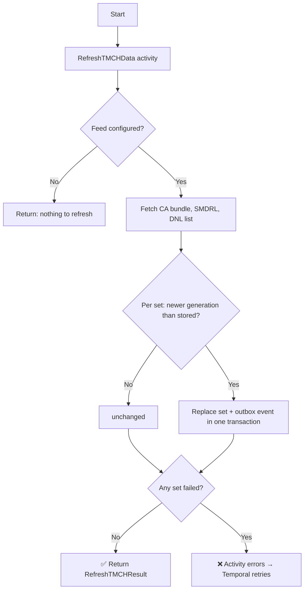

# Refresh TMCH Workflow

| Field | Value |
|-------|-------|
| **Status** | `ACTIVE` |
| **Queue** | `scheduled` |
| **Category** | `data` |
| **Tags** | `data`, `launch`, `tmch` |
| **Trigger** | `Schedule` / `REST` |
| **Human-in-the-Loop** | `No` |
| **Launchpad Card** | `Read-only (scheduled)` |

## Overview

The Refresh TMCH Workflow keeps the platform's copy of the **Trademark Clearinghouse data** current ([ADR 0024](../../../docs/adr/0024-launch-phases-and-epp-launch-extension.md) §4, roadmap 9a). The Clearinghouse publishes three data sets to registries, none of which belongs to a TLD or a phase:

- the **TMCH CA certificate bundle**, which signed marks (SMDs, RFC 7848) are verified against in a sunrise;
- the **SMD revocation list (SMDRL)**, the signed marks the Clearinghouse has revoked;
- the **DNL list**, the labels that match a trademark record, each with the lookup key a registrar needs for the claims notice.

One activity, `RefreshTMCHData`, downloads the three files, parses them, and **replaces each set whole** in the database when the Clearinghouse has generated a newer one than the one stored (delete and insert in one transaction, with a `tmch.<set>.refreshed` outbox event in the same transaction). The same generation fetched again writes nothing. A set that fails keeps what was stored.

On an installation with no TMCH credentials (`TMCH_USERNAME`, `TMCH_PASSWORD` unset) the activity reports that and does nothing, so the schedule exists everywhere and does work only where it can.

## Flow Diagram



## Input

```go
func RefreshTMCH(ctx workflow.Context, params RefreshTMCHParams) (RefreshTMCHResult, error)

type RefreshTMCHParams struct{}
```

## Output

```go
type RefreshTMCHResult struct {
    StartedAt   time.Time                `json:"startedAt"`
    CompletedAt time.Time                `json:"completedAt"`
    Refreshed   int                      `json:"refreshed"`
    Failed      int                      `json:"failed"`
    Sets        []queries.TMCHSetRefresh `json:"sets"`   // set, outcome (refreshed|unchanged|failed), error, status
    Notes       []string                 `json:"notes"`
}
```

## Query Handler

The workflow exposes a `progress` query handler returning the current `RefreshTMCHResult`.

## Steps

### 1. Refresh TMCH data
- **Activity**: `RefreshTMCHData` (struct method on `TMCHActivities`, through `services.TMCHService`)
- **Timeout**: 15 minutes (start-to-close), 5 minutes (heartbeat)
- **Retry**: Max 4 attempts, initial interval 1m, backoff coefficient 2.0, max interval 30min
- **Description**: fetches `TMCH_CA_URL` (public), then `TMCH_SMDRL_URL` and `TMCH_DNL_URL` with the registry's credentials; parses the CSV lists (version and generation time on the first line); stores each set whose generation is newer than the stored one. Safe to retry: a stored set is never replaced by the same or an older generation.

## Failure Modes

| Failure | Cause | Workflow Behavior | Manual Recovery |
|---------|-------|-------------------|-----------------|
| One set fails | Clearinghouse error, bad credentials, malformed file | The other sets are stored; the activity errors → retries → the run fails (visible red run); the stored set stands | Check the error in the result; `GET /tmch` shows what is stored; fix credentials or wait for the next run |
| All sets fail | Clearinghouse down, network error | As above | `TMCHDataStale` fires if it lasts; see the runbook |
| Crash mid-replace | Worker dies inside the transaction | Transaction rolls back; the previous generation remains | None needed |
| Feed not configured | No `TMCH_USERNAME`/`TMCH_PASSWORD` | The run completes with no sets and a note | Configure the feed if the installation runs sunrise or claims |

## Artifacts

No persistent artifacts. The sets are the `tmch_sets`, `tmch_certificates`, `tmch_smd_revocations` and `tmch_dnl_labels` tables.

## Operational Notes

### Scheduling
Runs every `TMCH_REFRESH_INTERVAL` (default 6h, minimum 1h). Schedule ID `refresh-tmch`, managed by bootstrap; the reconciler applies an interval change when the worker starts.

### Monitoring
- `GET /tmch` on the admin API reports each set's generation and fetch time.
- The admin API serves `tmch_set_generated_timestamp_seconds`, `tmch_set_fetched_timestamp_seconds`, `tmch_set_entries` and `tmch_certificates_not_after_timestamp_seconds`; the alerts in `prometheus/rules/tmch.rules.yml` link to [the runbook](../../../docs/epp/RUNBOOK.md#tmch-data-is-stale).

### Manual Intervention
- `POST /tmch/refresh` on the admin API (permission `registry:policy:admin`) runs the same refresh at once.
- Trigger `refresh-tmch` via the workflow API.

---

> **Last updated**: 2026-11-04
> **Updated by**: Agent — created with roadmap 9a (ADR 0024)
