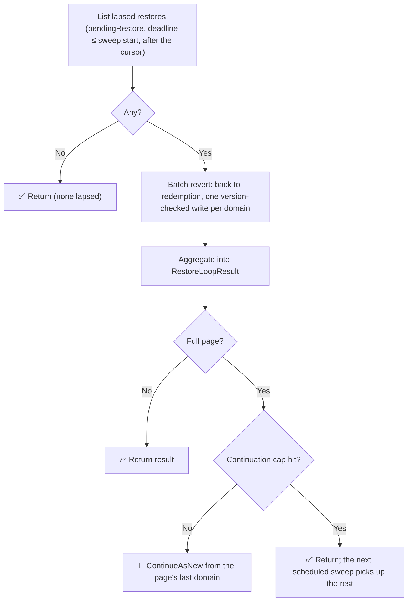

# Revert Lapsed Restores

| Field | Value |
|-------|-------|
| **Status** | `ACTIVE` |
| **Queue** | `lifecycle` |
| **Category** | `lifecycle` |
| **Tags** | `lifecycle`, `restores` |
| **Trigger** | `Schedule` (hourly, at :45) / `REST` |
| **Human-in-the-Loop** | `No` |
| **Launchpad Card** | `Read-only (scheduled)` |

## Overview

A deleted domain is restored in two EPP steps (RFC 3915): the sponsor **requests** the restore, which makes the domain `pendingRestore` (its EPP status stays `pendingDelete`), then sends the **restore report**, which restores it in the same command. This workflow handles the third case: a request whose report never came.

A request lapses at its `pendingRestoreEnd`: the end of the TLD phase's **pending restore period** (7 days by default, as for .com). Every hour the workflow lists the domains whose request has lapsed and reverts each one (`entities.Domain.RevertRestore`): `pendingRestore` is cleared and the domain is `pendingDelete` as it was before the request, in its redemption period if that has not ended, with its original purge date. Nothing is charged; the revert is recorded as a `domain.restore_reverted` event carrying the workflow ID as correlation ID and the run ID as trace ID (INV-16). The registrar may request a restore again while the redemption period lasts.

Until it is reverted, a domain with a lapsed request is refused a report (2304) and is not purged, even past its purge date. So this workflow's hourly cadence decides only how soon `<domain:info>` stops showing `pendingRestore`.

It no longer completes restores: before Phase 4i-2 it finalised every `pendingRestore` domain, with no report and up to four hours late. The restore and its charges (the restore fee and the renewal) now happen in the command that sends the report. The full process is documented in `pkg/domain/entities/restore.go` and on the admin UI's *Domain Restore* page.

**Idempotency.** The batch reads and checks every domain again before reverting it. A domain restored meanwhile, already reverted by an earlier attempt, or whose request has not lapsed is reported as `Skipped`. A domain changed while it is reverted is read and checked again, up to three times.

**One sweep, a page per run.** A sweep lists the restores lapsed as of its start, a page (`BatchSize`, default 1,000) per run, in (`pendingRestoreEnd`, ROID) order, served by the `pending_restore_end` index. A full page continues-as-new from the page's last domain, carrying the sweep's time and that cursor, so a domain that cannot be reverted is passed over and cannot hold back the ones after it; the next sweep retries it. The continuation cap (`maxContinuationRuns`, 50) bounds a sweep.

## Flow Diagram



## Input

```go
type RestoreLoopParams struct {
    BatchSize         int       `json:"batchSize,omitempty"`         // default 1000
    ContinuationCount int       `json:"continuationCount,omitempty"` // managed by the workflow
    DueBy             time.Time `json:"dueBy,omitempty"`             // the sweep's time; managed
    AfterRestoreEnd   time.Time `json:"afterRestoreEnd,omitempty"`   // the cursor; managed
    AfterRoID         int64     `json:"afterRoid,omitempty"`         // the cursor; managed
}
```

## Output

```go
type RestoreLoopResult struct {
    StartedAt, CompletedAt, DueBy time.Time
    TotalFound, TotalProcessed    int
    Reverted, Failed, Skipped     int
    Notes                         []string
    Failures                      []RestoreFailure // up to 50 samples
}
```

## Query Handler

`progress` returns the current `RestoreLoopResult`.

## Steps

| Step | Activity | What it does |
|---|---|---|
| List lapsed restores | `ListLapsedRestores` | Domains `pendingRestore` with `pendingRestoreEnd` at or before the sweep's start, in (deadline, ROID) order after the cursor |
| Batch revert | `BatchRevertLapsedRestores` | `DomainService.BatchRevertLapsedRestores`: re-checks and reverts each |

## Settings

The pending restore period is set per TLD phase (`pendingRestorePeriod`, see `docs/epp/POLICY_REFERENCE.md`). It applies to restores requested after a change: a pending restore keeps its deadline. A phase with `restoreReportRequired` false restores on the request alone, so this workflow never sees its domains.
