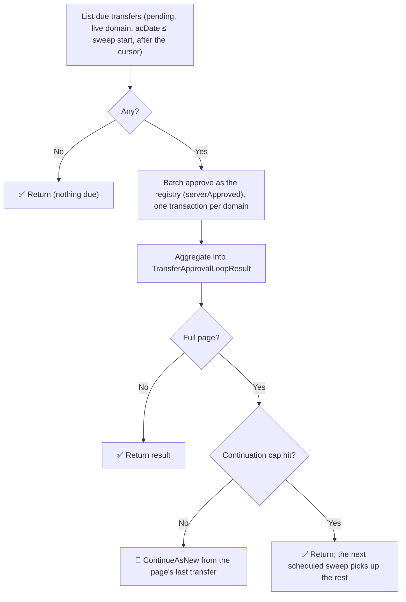

# Transfer Approval Loop

| Field | Value |
|-------|-------|
| **Status** | `ACTIVE` |
| **Queue** | `lifecycle` |
| **Category** | `lifecycle` |
| **Tags** | `lifecycle`, `transfers` |
| **Trigger** | `Schedule` (hourly, at :15) / `REST` |
| **Human-in-the-Loop** | `No` |
| **Launchpad Card** | `Read-only (scheduled)` |

## Overview

A domain transfer the losing registrar neither approves nor rejects within the TLD phase's **pending transfer period** (5 days by default) is approved by the registry. That is the ICANN Transfer Policy's rule, and RFC 5731's `serverApproved` transfer status.

Every hour, the loop lists the pending transfers whose `acDate` (the end of the pending transfer period, set when the transfer was requested) has passed, and approves them in batches. Transfers of domains that no longer exist are left out: their history stays pending, but there is nothing left to approve. An approval by the registry completes the transfer exactly as an approval by the losing registrar does (`DomainService.ResolveTransferAsRead`, one database transaction):

- the domain moves to the gaining registrar, its expiry extended by the transfer period;
- its transfer code is cleared, it enters the transfer grace period (`transferPeriod`) and a new transfer lock;
- its nameservers follow it: hosts under the domain move with it, external nameservers are re-linked to the gaining registrar's hosts, and hosts under other domains keep their links;
- the gaining registrar is charged, recorded on a `domain.transferred` event carrying the workflow ID as correlation ID and the run ID as trace ID;
- **both** registrars get a poll message, *Transfer approved by the registry*; the gaining registrar's says to replace the contacts.

The full process is documented in `pkg/domain/entities/transfer.go` and on the admin UI's *Domain Transfers* page.

**Idempotency.** The batch reads and checks every domain again before approving it. A transfer answered by a registrar meanwhile, approved by an earlier attempt of this activity, or not yet due is reported as `Skipped`, so a retry never approves a transfer twice. A domain changed while it is being approved is read and checked again, up to three times.

**One sweep, a page per run.** A sweep lists the transfers due as of its start, a page (`BatchSize`, default 1,000) per run, in (`acDate`, ID) order. A full page continues-as-new from the page's last transfer, carrying the sweep's due time and that cursor. So a transfer that cannot be approved is passed over, not listed again, and cannot hold back the transfers after it; the next hourly sweep retries it. The continuation cap (`maxContinuationRuns`, 50) bounds a sweep.

**Tracing (INV-16).** The activities call `DomainService` directly, so they set what the admin API's headers would: the workflow ID as correlation ID and the run ID as trace ID, on every event the approvals write.

## Flow Diagram



## Input

```go
type TransferApprovalLoopParams struct {
    BatchSize         int       `json:"batchSize,omitempty"`         // default 1000
    ContinuationCount int       `json:"continuationCount,omitempty"` // managed by the workflow
    DueBy             time.Time `json:"dueBy,omitempty"`             // the sweep's due time; managed
    AfterActionDate   time.Time `json:"afterActionDate,omitempty"`   // the cursor; managed
    AfterID           int64     `json:"afterId,omitempty"`           // the cursor; managed
}
```

## Output

```go
type TransferApprovalLoopResult struct {
    StartedAt, CompletedAt, DueBy time.Time
    TotalFound, TotalProcessed    int
    Approved, Failed, Skipped     int
    Notes                         []string
    Failures                      []TransferFailure // up to 50 samples
}
```

## Query Handler

`progress` returns the current `TransferApprovalLoopResult`.

## Steps

| Step | Activity | What it does |
|---|---|---|
| List due transfers | `ListDueTransfers` | Pending transfers of existing domains with `acDate` at or before the sweep's start, in (`acDate`, ID) order after the cursor (`idx_domain_transfers_pending`) |
| Batch approve | `BatchApproveDueTransfers` | `DomainService.BatchApproveDueTransfers`: re-checks and approves each as `serverApproved` |

## Settings

The pending transfer period is set per TLD phase (`pendingTransferPeriod`, see `docs/epp/POLICY_REFERENCE.md`). It applies to transfers requested after a change: a pending transfer keeps the `acDate` it was given.
